# Poga Poga — 最小可玩版本（v0.191）

俯视角史莱姆（鼻涕虫）融合竞速。玩家控制一只史莱姆在黑白林间小道上慢慢蠕动、滑行、转向；
靠近其他史莱姆时**躯体会真正融合成一坨连续的黏液**，只有眼睛各自露在外面；
真正的碰撞发生在**眼睛之间**——眼睛撞到一起会减速、稳定崩溃、约束松弛，甚至把整团撞散。

> 基于 `策划案/《Poga Poga》策划案 v0.2.md` 落地。
> **长期全局要求见 [GLOBAL_REQUIREMENTS.md](GLOBAL_REQUIREMENTS.md)**（风格/音频/玩法/自检/协作约束）。
> **v0.5 按试玩反馈改版**：UI 统一、取消镜头旋转、耐力真正生效、经验/等级替换点数、
> AI 性格、障碍物可读性、史莱姆表情形态、玩家史莱姆音效。
>
> **v0.6 音频升级**：史莱姆拟声改用 Qwen3-TTS 生成并做“小动物化”后期；新增柔和森林风
> 芯片 BGM（循环、淡入、`M` 静音）与按键音效（点击/确认/返回）。
>
> **v0.7**：修复耐力条不刷新 + 耐力更慢但低耐力明显降速；win~ win~ 随速度变调；
> AI 耐心加长并真正轮换领骑；电子游戏机 CRT 画面；前三关首次进入实时操作引导；
> 新增两关环法赛段（平原 / 山地），上下坡改为渐变条带 + 方向箭头 + HUD 坡度提示。
>
> **v0.8**：背景音乐换成柔和的音乐盒/原声风（去掉合成器与低音长音）；win~ win~ 只在真正
> 加速时响、提速越快越急；主菜单改为极简游戏机风格，选关与加点拆成独立界面；环法两关
> 扩成大体量赛段（更多圈数/起伏/障碍/AI）；耐力条改成带峰值保持（peak hold）的动态条；
> 前三关操作引导每次进入都显示，选关界面可勾选跳过。
>
> **v0.9**：主菜单重做成真正的游戏机标题画面（CRT 外壳/扫描线/闪烁 PRESS ENTER/小史莱姆吉祥物）；
> **选关即开始**（点赛段直接出发）；前两关环法合并成 1 个 3 圈最终赛段（共 4 关）；
> 操作引导改为**慢动作聚焦**，第一关开赛前先上一段学习移动的序章，开到起跑线才发车；
> 耐力条重做为**腰型槽**（无分段、无数字，只在 30% 画线，上限决定槽长），耐力低于 30% 才掉上限，
> 低耐力/清空有**发抖动画 + 喘息音效**，清空后有喘息锁定；连点标题 7 下解锁全部赛段。
>
> **v0.10**：主菜单改为**街机 attract 模式**（进入时只有 LOGO + 闪烁 PRESS ENTER，按任意键才出现选项）；
> 去掉副标题与版权标记，换成夜色森林 + 飘叶的 CRT 内屏）；win~ win~ **音高固定**，只按提速幅度改变
> “叫的频率”；低耐力/清空音效换成程序化合成的**软喘息 + 短促吱声**（渐入渐出，不再割裂）；
> 耐力条腰型重做（最窄处=30% 阈值，去掉刻线/数字、始终居中、呼吸流光），清空回弹的同时**临时上限直接掉一截**。
>
> **v0.11**：win~ win~ 增加 3 个**同音高、不同语气**的变体并用播放器池轮换（永不截断上一声）；
> 主菜单去掉屏幕闪烁、`PRESS ANY KEY` 移到画面下方居中；游戏内 **Esc 改为暂停菜单**（继续/重试/返回主菜单），
> 不再直接退出；耐力条改成**折线轮廓的腰型**，最窄折点对应原始耐力 30%（上限缩小时动态换算），
> 保持无刻线/无数字、始终居中。
>
> **v0.12**：加点界面拆成「洗点（返还加点，保留等级/经验）」与「重置车手等级（二次确认）」；
> 修复 **Esc 在选关/车手/操作说明界面无效**的问题；新增**操作说明界面**（键位/融合/耐力/暂停说明）。
>
> **v0.13**：修复**暂停不真的暂停**（世界层改为 PAUSABLE，并加 `--pause-check` 自检）；
> 操作引导改为**提示时聚焦慢动作**（短暂减速 + 镜头拉近 + 四周压暗，提示读完立即恢复）；
> 重做坡道视觉（上坡变暗 + 向上箭头 + 斜线纹理，下坡变亮 + 反向箭头，入口小旗）；
> **FINALE 重做成一张双回环大图**（窄颈 + 两处减速弯 + 7 段坡道 + 障碍，1 圈长赛段，9 只 AI）；
> 新增 [GLOBAL_REQUIREMENTS.md](GLOBAL_REQUIREMENTS.md) 长期记录全局要求。
>
> **v0.14**：情境提示重做——坡度在**进入坡道前**提示、低耐力/障碍/纵列/融合/眼睛在**第一次遇到**时提示，
> 每条只显示 1 秒；聚焦效果大幅加强（上下黑边 + 四角取景框 + 强压暗 + 镜头拉近），之前“看不出来”的问题解决；
> 融合团横向约束放松（主动打方向时进一步放松），脱团冲刺的黏连感明显降低；
> FINALE 扩成约 12.8km、1 圈的**分层大地图**：双回环 + 窄颈 + 两处减速弯 + 8 段坡道 + 四段地形
> （林间/旷野/岩地/高地，路肩色带、叶片颜色、路边道具与 HUD 赛段名随地形变化）。
>
> **v0.15（2D 最后一版）**：耐力系统加入**崩溃线**——临时上限可以跌破 30%，此后加速会持续掉上限且无法恢复；
> 上限与耐力同时见底时史莱姆**爆炸散开**，2.4 秒后重新聚合（耐力 0.35 / 上限 0.55）；
> 补充低耐力半垂眼、耗尽闭眼、爆炸散开表情，并把碰撞表情改为清楚的“><”（尖头相对）；
> 第一关序章改为**按下对应按键立即进入下一步**；选关新增“需要操作指引”勾选框（勾选后前三关第一次遇到情境会提示）。
>
> **v0.16**：表情改为 **“--”/“==”**，眼睛始终水平排列，“><”再也不会因为朝向变成上下堆叠；
> 团内眼睛碰撞也会掉耐力；喘息锁定期间耐力保持 0，**回弹与上限下降真正同帧**；
> 爆炸时耐力条**右侧碎裂消失、左侧余量流失**；爆炸改为**分裂成 7 只小史莱姆**，各自乱走，
> **持续按移动键**才会聚合；主菜单云朵换成游戏内叶片；Esc 回主菜单不再触发 PRESS ANY KEY；
> 第一关序章改成**空地上的自由练习**（不慢动作/不聚焦），开到起跑门才**加载赛道**。
>
> **v0.17**：序章起跑线改为和游戏内完全相同的黑白格，并在空地四周补了叶片/草丛/石块装饰；
> 眼睛连线改为**跟随运动方向旋转**（不再永远屏幕水平）；耐力条**一过崩溃线（上限 <30%）右侧就永久破碎**，
> 并去掉上方闪烁白线；修复“勾选需要操作指引也没提示”——旧存档自动开启引导、重新勾选会重置已提示记录；
> 新增 [docs/文案清单.md](docs/文案清单.md)，列出全部玩家可见文案的代码位置并顺手修了几处逻辑/语气问题。
>
> **v0.18**：操作指引改为**每次进入前三关都重新提示**；耐力条崩溃后改成**碎裂动画 + 残槽逐步流失 + 飞散碎片**；
> 上下坡地面补上明显的整体明暗变化；结算数据统一**靠右 + 逐条淡入**；
> 对手改为 **善良 / 和平 / 邪恶** 三种性格（全部使用困难难度数值），善良主动找 Poga 合体、邪恶会甩开并偶尔冲撞；
> 靠近 AI 时头顶显示细耐力线；玩家史莱姆正式定名 **Poga**，新增 [docs/文案风格指南.md](docs/文案风格指南.md)。
>
> **v0.19**：AI 头顶耐力线只在**融合体内前后左右/极近**时显示最近的一个，并做淡入淡出不再闪；
> 邪恶 AI 改为**彼此协作**（优先找邪恶同伙合体），只对 Poga 排斥/冲撞，不再为了甩人把自己开慢；
> 下坡路段改成**整片明显提亮**；结算取消 R/Enter/Esc 快捷键，改成“方向键选按钮 + Enter 确认”；
> 修复重试后一直慢动作：开始/重试关卡与引导/提示退出时都强制把 `Engine.time_scale` 复位到 1.0。

---

## 快速开始

**环境**：Godot **4.7.2**（`4.7.x` 均可），Windows 默认 `d3d12 + mobile` 渲染后端。

```bash
# 方式 A：用 Godot 打开 project.godot，F5 运行（主场景 res://scenes/main.tscn）
# 方式 B：命令行
godot --path .
```

首次运行自动导入字体与音效。工程无第三方插件依赖。

**操作**

| 行为 | 键盘 | 手柄 | 触屏（原型） |
| --- | --- | --- | --- |
| 加速 | `W` / `↑` | `A` / 右扳机 | 按住屏幕 |
| 刹车 | `S` / `↓` / `空格` | `B` / 左扳机 | 双指按下 |
| 左转 / 右转 | `A` `D` / `←` `→` | 左摇杆 | 左右拖动 |
| 滑行 | 松开所有键 | — | 松手 |
| 重试 | `R` | `Y` | 结算按钮 |
| 返回菜单 | `Esc` | `Start` | 结算按钮 |
| 音乐静音/恢复 | `M` | — | — |
| 开关像素化（调试） | `F3` | — | — |

**过关条件**：玩家个体排名第一。失败可无限立即重试。

---

## 本轮改了什么（v0.5）

| # | 反馈 | 处理 |
| --- | --- | --- |
| 1 | 主菜单 UI 风格要统一 | 重做 [main_menu.gd](src/ui/main_menu.gd)：与结算/HUD 共用同一套 [UiKit](src/ui/ui_kit.gd)（像素字体、直角细边框、统一字号层级、统一选中态），顶部身份区 + 左右两栏 + 底部操作条 |
| 2 | 镜头旋转头晕 | **取消相机旋转**（固定朝向、上=北），只保留平滑跟随 + 速度/团规模缩放 |
| 3 | 耐力条像摆设 | 耐力消耗改为「基础消耗 + 速度相关消耗」（低速也持续掉），上限也会明显下降；HUD 改成大号分段条 + 百分比数字 + 低耐力闪烁 + 上限刻线 |
| 4 | 点数增益过大、太容易获得、重置回到 5 级 | 改为**经验升级**：每场按「排名 × AI 难度 × 关卡难度」得经验，升级所需经验递增（80 + 30×等级），每级 +1 加点；属性等级 **0→5** 起步，重置回到 **Lv.0 / 0 经验 / 0 加点**；单点增益下调（速度 +3%/点等）。**AI 分三档**：简单/普通/困难，对手属性、失误率、弯道刹车、领骑耐心、融合倾向逐档增强，经验加成 ×1.0 / ×1.45 / ×2.0 |
| 5 | 障碍物看不清 | 凋落物全部加 **白描边 + 深色主体 + 双色警示环**，并在浏览器尺寸下重新调过对比度 |
| 6 | 史莱姆形态 | 加速时两眼**靠近**（×0.78），刹车时**拉远**（×1.30）；碰撞时眯成 **`><`** 并左右晃动（眼睛与黏液躯体一起抖） |
| 7 | 音效 | 新增玩家史莱姆位置音源 [slime_audio.gd](src/audio/slime_audio.gd)：加速循环「win~ win~」、刹车循环「Pooo~」、碰撞一次性「Poga」；音频由 [gen_audio.py](tools/gen_audio.py) 生成（Qwen3-TTS + 程序化） |
| 8 | BGM 与按键音 | v0.6：27 秒森林风芯片 BGM（循环/淡入/`M` 静音）、UI 点击/确认/返回音效 |

## 导出产物（v0.191）

- Windows：`build/windows/PogaPoga.exe`
- Android：`build/android/PogaPoga.apk`（debug 签名）
- 图标：`icon.png` / `icon.ico` / `icon_192.png` / `icon_432.png`
- 详细命令与模板路径见 [docs/导出说明.md](docs/导出说明.md)。

## v0.191 需求清单（最后更新）

> 本轮把此前遗留问题与移动端/设置相关需求集中记录在这里，完成一项勾掉一项。

### 修复
- [x] 下坡路段整段调亮（现在和平路同色）。
- [x] 结算界面用方向键高亮其它按钮后，按 Enter 仍然触发第一个按钮。
- [x] 选关界面左下空白处显示**地图整体画面 + 关卡介绍**。

### 移动端与操作
- [x] 横屏移动端版本，两种操作方式：
  1. **触屏**：按住屏幕左侧左转、右侧右转，两侧同时按前进；屏幕下划并按住刹车，松手才结束刹车。优先级：刹车 > 加速 > 左右转 > 滑行。
  2. **陀螺仪**：以开始比赛时的角度为基准=滑行；倾斜方向分解到 Poga 朝向：同向加速、反向刹车、垂直于朝向左右转。
- [x] 四份操作指引：键盘 / 手柄 / 触屏 / 陀螺仪；按当前输入自动匹配。陀螺仪仅在移动端且设置勾选“开启陀螺仪”时启用；陀螺仪与触屏互斥。
- [x] “操作说明”改为“设置”，包含：
  - **操作**：改键；每个操作有 2 个备用键；按键不能冲突；监听改键；移动端显示“开启陀螺仪”勾选框。
  - **声音**：音效音量、BGM 音量滑条（独立 SFX / Music 总线）。
  - **画面**：窗口大小（移动端隐藏，自动适配）、帧率上限（不超过识别到的屏幕刷新率）。

### 文案
- [x] 玩家史莱姆统一叫 **Poga**；语气遵循 [docs/文案风格指南.md](docs/文案风格指南.md)。

## 本轮改了什么（v0.191）

| # | 内容 | 处理 |
| --- | --- | --- |
| 1 | 下坡和平路同色 | 坡道 tint 改为**整段统一色块**：上坡黑 0.44、下坡白 0.52（按坡度强度），不再只在中间亮；HUD 上坡/下坡与箭头保留 |
| 2 | 结算 Enter 总触发第一个按钮 | 结算出现时关闭 Race 的输入处理（Race 曾在 FINISHED 状态吞掉 confirm 并重试）；按钮只响应焦点 + Enter |
| 3 | 选关左下空白 | 新增 `TrackMiniMap`：整条赛道轮廓、起点、坡道点，放在赛段列表下方，配合关卡介绍 |
| 4 | 移动端/触屏/陀螺仪 | 横屏；触屏左/右半屏转向、双按加速、下划按住刹车（刹车>加速>转向>滑行）；陀螺仪以开局角度为基准分解到 Poga 朝向；设置里可开关陀螺仪（移动端），陀螺仪与触屏互斥 |
| 5 | 四份操作指引 | HUD 开局按识别到的输入显示键盘/手柄/触屏/陀螺仪指引；设置-操作页也显示“当前输入”对应说明 |
| 6 | 设置界面 | 主菜单“操作说明”改为“设置”：操作（8 个动作 ×2 键、监听改键、冲突检测）、声音（SFX/BGM 滑条）、画面（窗口大小、帧率上限；移动端隐藏窗口） |
| 7 | 手柄改键 / A 确认 / 输入识别 | 设置-操作新增“键盘/手柄”改键对象切换，手柄每个动作也能改 2 个备用键；手柄 A 加入 `ui_accept`；输入识别改为“最近一次真实输入”：手柄空闲时按键盘会切回键盘 |
| 8 | Press Any Key 支持手柄/触屏 | 主菜单揭幕接受键盘、手柄按键、鼠标与触屏按下 |
| 9 | 嵌入窗口改大小警告 | 编辑器内嵌窗口不执行 `window_set_size`，避免 “Embedded window can't be resized” 警告 |
| 10 | 默认焦点 / 设置切页崩溃 / 手柄键 | 设置、车手界面补默认焦点；设置切页时清空旧按钮引用，修复切回操作页崩溃；手柄按钮 0（A）不再被当成空，改键真正写入 InputMap |
| 11 | 图标与导出 | 新 Poga 图标（png/ico）；`export_presets.cfg`；Windows exe 与 Android debug APK 已导出，见 [docs/导出说明.md](docs/导出说明.md) |
| 12 | 移动端触屏/陀螺仪 | 主菜单触屏揭幕修复；陀螺仪仅在设备真实有传感器时显示开关；操作指引按键盘/手柄/触屏/陀螺仪自动匹配；移动端右上角加暂停按钮 |
| 13 | 移动端性能/模拟器 | 移动端改用 GL Compatibility + viewport 拉伸；APK 改为 arm64 + armv7 + x86_64 通用包，Mumu x86_64 模拟器已实测可启动 |
| 14 | 版本号 | README/规范/全局要求更新到 v0.191 |

> 说明：移动端触屏/陀螺仪代码已接入并通过桌面编译/无头回归；真机手感需要在手机上实际验证。

## 本轮改了什么（v0.19）

| # | 反馈 | 处理 |
| --- | --- | --- |
| 1 | AI 耐力条要更近才显示，而且会闪 | 改为只显示**最近的一个**：融合体内 115px 或非融合 82px 内；目标切换时淡入，离开淡出，不再每帧出现/消失闪烁 |
| 2 | 邪恶 AI 应该彼此协作，只排斥 Poga，现在为了甩人自己变慢 | 邪恶 AI 优先寻找其他邪恶 AI 合体；只在对 Poga 极近时轻微侧让，主要靠提速甩开与周期性冲撞，不再大幅偏离赛车线 |
| 3 | 下坡没有整片变亮 | 下坡白色 tint 提高到 0.56，并让整段都保持高 alpha（不再中间亮两边几乎没有）；上坡保持深色 tint |
| 4 | 结算按钮改成选中后 Enter 确认 | 移除结算界面的 R/Enter/Esc 快捷键与对应文案；按钮只保留“重试 / 下一关 / 返回菜单”，方向键选中后 Enter 触发 |
| 5 | 重试后一直慢动作 | `start_level` 开头强制 `Engine.time_scale=1.0`；引导/提示退出时也固定恢复 1.0；新增 `--retry-check` 自检 |

## 本轮改了什么（v0.18）

| # | 反馈 | 处理 |
| --- | --- | --- |
| 1 | 开指引时希望每次进入前三关都有提示 | 情境提示改为**每局独立计数**（不再用全局 `tips_seen`），每次进入关卡都会在第一次遇到各类情况时重新提示；序章也每次显示 |
| 2 | 过崩溃线后的耐力条不好看，要动效 | 耐力槽重写破碎表现：上限跌破 30% 时左侧残槽保留，右侧产生锯齿裂口并飞出带旋转/重力的碎片（1 秒动画），残余耐力在左侧继续流干；残槽至少保留 260px 可读宽度 |
| 3 | 上下坡只有斜线、没有明暗 | 坡道整体明暗加强：上坡黑色 tint 0.34、下坡亮色 tint 0.30，按坡度强度缩放且整段生效；斜线纹理与箭头保留 |
| 4 | 结算数据要靠右、一条条显示 | 结算行改成“左项目 / 右数值”的 HBox，数值统一靠右；每行错开 0.06s 淡入，总用时/圈数/经验依次出现 |
| 5 | 对手 AI 改成善良 / 和平 / 邪恶 | 三种性格统一使用困难难度数值；善良主动靠近 Poga 合体，和平正常跑，邪恶会甩开 Poga 并每 3.6s 左右尝试一次冲撞，且拒绝与 Poga 融合 |
| 6 | 靠近 AI 显示头顶耐力细线 | 新增 `RivalBars`：距离 Poga 320px 内的 AI 头顶显示细线，长度 = 当前耐力 |
| 7 | 玩家史莱姆叫 Poga；文案风格整理 | UI 中玩家史莱姆统一称 **Poga**；新增 [docs/文案风格指南.md](docs/文案风格指南.md)，从当前 UI（时间暂停/继续吧/再来！/不玩啦/拿下！/可惜/选择地图）提炼短句口语风格 |

## 本轮改了什么（v0.17）

| # | 反馈 | 处理 |
| --- | --- | --- |
| 1 | 序章起跑线要和游戏内一样；空地太素 | 序章直接调用 `_draw_start_line()` 画与游戏内一致的黑白格；空地增加 420 个叶片/草丛/石块/地面斑块装饰，中间保留练习区 |
| 2 | 操作指引好像没了，勾选后也没提示 | 存档版本升到 9：旧存档自动 `guide_enabled=true` 并清空 `tips_seen`；重新勾选“需要操作指引”时也会重置提示记录。之前是旧存档的 `skip_tutorial` 把引导关掉了 |
| 3 | 耐力条右侧应过崩溃线就破碎；不要闪烁白线 | 上限低于 30% 时耐力条右侧立刻变为锯齿缺口+碎片并保持破碎（不再等爆炸）；左侧保留当前耐力；删掉了槽体上方的闪烁白线，只保留外框轻微呼吸 |
| 4 | 眼睛之间的连线要和运动方向一致 | 两眼位置改为沿 `forward.orthogonal()` 排列，连线随朝向/运动方向旋转；碰撞判定同步使用同一组眼睛坐标，`><` 的朝向也跟随运动方向 |
| 5 | 给文案位置并检查逻辑/语气 | 新增 [docs/文案清单.md](docs/文案清单.md)（自动扫描，已过滤调试日志）；修正 FINALE 简介仍写“3 圈”、暂停页重复提示、结算页“玩家个体第一”等机翻感/错误文案 |

## 本轮改了什么（v0.16）

| # | 反馈 | 处理 |
| --- | --- | --- |
| 1 | 低耐力/耗尽表情要 `--` 和 `==`；碰撞 `><` 方向不对（好像一眼在上一眼在下） | 低耐力：两只眼睛各一条横线 `--`；耗尽：各两条横线 `==`；眼睛不再跟随身体旋转，始终屏幕水平排列，碰撞时左眼 `>` 右眼 `<` 尖头相对，不会变成上下堆叠 |
| 2 | 融合体内眼睛碰撞不掉耐力 | 眼睛碰撞（含同团）给双方各扣 `EYE_STAMINA_DRAIN` 耐力，HUD 立即下降 |
| 3 | 耗尽回弹还是没和上限下降同步 | 喘息锁定期间耐力保持 0（不再偷偷回一点），锁定结束的同一帧执行上限 `-0.10` 与回弹，并把耐力压到新上限内 |
| 4 | 崩溃时耐力条右侧破碎、左侧表现流失 | 耐力槽新增破碎状态：右侧 45% 被锯齿裂口覆盖并飞出碎片，左侧保留槽体、残余耐力随 2.4 秒流失；聚合后恢复正常 |
| 5 | 爆炸效果要分裂成多个小史莱姆、乱走、按移动键才聚合 | 爆炸后本体 blob 隐藏，分裂出 7 只带小眼睛的迷你史莱姆，各自游走；等待 0.9s 后**必须持续按移动键**才会把它们拉回，进度满才聚合；聚合耐力 0.45 / 上限 0.75 |
| 6 | Esc 返回主菜单会触发 PRESS ANY KEY | 主菜单启动后 0.22s 内忽略输入；暂停菜单返回主菜单时也标记输入已处理 |
| 7 | 主菜单云朵换成游戏内叶子 | 背景树冠改为两层叶片剪影（与赛道叶子同款透镜形），缓慢摆动 |
| 8 | 第一关指引不要慢动作/聚焦，先在空地练习，最后才加载赛道 | 序章改为**空场地**（只有地面与起跑门），不慢动作、不聚焦；玩家自由练习加速/转向/刹车/滑行，开到起跑门才加载完整赛道并开始倒计时；选关的“需要操作指引”开关仍保留 |

## 本轮改了什么（v0.15）

| # | 反馈 | 处理 |
| --- | --- | --- |
| 1 | 耗尽回弹时临时上限没同时下降；低耐力/耗尽表情没做；碰撞表情要“><”尖头相对 | 喘息结束回弹的同一帧执行 `cap -0.10` 并把耐力压到新上限以内；临时上限下限从 0.35 改成 **0.10**；新增低耐力半垂眼、耗尽闭眼、爆炸散开三种表情；碰撞眯眼重写为左眼“>”右眼“<”的**尖头相对**“><” |
| 2 | 第一关移动指引按下键就进下一步；需要“是否开启指引”勾选框，勾选后前三关第一次遇到情况会提示 | 序章步骤条件放宽为“按下对应键”（最小停留 0.12s）；新增 `guide_enabled` 持久化开关，选关界面「需要操作指引：开/关」；勾选后启用第一关序章 + 前三关情境提示 |
| 3 | 新机制：上限可低于 30%，之后加速持续掉且不能恢复；彻底耗尽爆炸散开，一段时间后聚合 | 上限 <30% 时禁止自然恢复，加速额外流失 `0.022/s`；上限到 0.10 且耐力见底时触发爆炸：断开融合团、失控 2.4s、散成小团，然后以 **耐力 0.35 / 上限 0.55** 重新聚合；HUD 耐力槽在上限 <30% 时急促警示闪烁 |
| 4 | 最后验收 | 新增制作者 / 试玩者 / 裁判三份本地验收脚本与报告（`tools/agents/`、`docs/acceptance_*.md`），分别做编译与功能静态检查、运行时机制验收、全量回归与文档一致性裁决 |

## 本轮改了什么（v0.14）

| # | 反馈 | 处理 |
| --- | --- | --- |
| 1 | 上下坡提示应在快进入坡道时；低耐力/障碍等提示应只在第一次遇到时出现；纵列提示在离团太久时出现；每条只显示 1s | 新增 [tip_overlay.gd](src/ui/tip_overlay.gd)：8 类情境提示（上/下坡、低耐力、障碍、贴边、纵列、融合、眼睛），用 `GameState.tips_seen` 持久化“第一次”；坡度在进入前 25~320px 触发、障碍在前方 260px 触发、纵列在离团约 6s 触发；每条显示 1.0s 后自动结束；第一关序章保留，1/2 关不再用整段步骤列表 |
| 2 | 画面聚焦几乎看不出来 | 聚焦表现大幅加强：上下黑边（90px）+ 四角取景框 + 玩家周围强压暗（14 层）+ 镜头拉近 1.34× + 0.32× 慢动作；提示结束后立即恢复；序章与情境提示共用同一套聚焦语言 |
| 3 | 混合后转向太难、脱团冲刺黏连感重 | 横向弹力 5.5→3.0、阻尼 0.18→0.10、散团横向阈值 50→34、散团距离 72→64、吸附冷却 0.7→1.1s；主动打方向时横向刚度再降到 30%，更容易“打方向 → 脱团 → 冲刺” |
| 4 | FINALE 还是太短、层次感弱 | 扩大为约 **12.8km / 1 圈**；新增 **4 段地形**：林间 / 旷野 / 岩地 / 高地；路肩色带、叶片颜色、路边道具（草丛/石块/雾带/蘑菇）与 HUD 赛段名随分区变化；8 段坡道 + 7 处障碍 + 9 只 AI |

## 本轮改了什么（v0.13）

| # | 反馈 / 自检 | 处理 |
| --- | --- | --- |
| 1 | 局内按 Esc 暂停没有真的暂停 | 根因：Main 设成 `PROCESS_MODE_ALWAYS` 后，子节点 Race 继承 ALWAYS，`get_tree().paused` 对它无效。现在世界层 `_world_root` 与 Race 显式设为 `PROCESS_MODE_PAUSABLE`；新增 `--pause-check` 自动断言暂停期间 `race_time` 不增长（实测 PASS） |
| 2 | 操作指引要“需要操作/提示时”才慢动作，并聚焦画面 | 每个提示出现时短暂减速（第一关 0.22×、其它关 0.45×，持续 1.7s）+ 镜头拉近 1.16× + 玩家周围留清晰区、四周压暗；提示读完立即恢复正常速度，让玩家自己完成动作 |
| 3 | 引导说看地面明暗，实际看不出来 | 重做坡道视觉：上坡铺**明显变暗**的路面 + 向上箭头 + 斜线纹理；下坡**变亮** + 反向箭头 + 另一方向斜线；坡道入口两侧加小旗。引导文案改成“路面变暗/变亮 + 箭头”与实际一致 |
| 4 | 第四关要有意思、不要干绕圈 | FINALE 重做为**双回环大图**：`_peanut_points` 生成两个大回环 + 收窄的窄颈 + 两处减速弯（局部内凹），1 圈约 10.7km、7 段坡道、7 处障碍、9 只 AI；`--track-preview` 可截整图检视 |
| 5 | 全局要求容易被上下文压缩丢掉 | 新增 [GLOBAL_REQUIREMENTS.md](GLOBAL_REQUIREMENTS.md)：硬约束、视觉/音频/玩法/引导/工程自检/协作方式与回归清单 |

## 本轮改了什么（v0.12）

| # | 反馈 / 自选功能 | 处理 |
| --- | --- | --- |
| 1 | 重置等级会把点数也清零 | 拆成两个明确操作：**洗点**只返还全部已用加点，保留车手等级、经验与解锁；**重置车手等级**才清空等级/经验/加点，并且需要**二次确认**（3 秒内再点一次），避免误触 |
| 2 | 加点界面按 Esc 返回不了 | 修复 `Main._unhandled_input` 的返回逻辑：选关 / 车手 / 操作说明三个界面按 Esc 都返回主菜单（之前的分支在加入暂停功能时丢失了） |
| 3 | 自选功能 | 新增**操作说明**界面（主菜单第二项）：键位、融合与眼睛碰撞、耐力规则、暂停/重试/静音等一页看完；主菜单仍是 attract 模式（按键后才出现 4 个选项） |

## 本轮改了什么（v0.11）

| # | 反馈 | 处理 |
| --- | --- | --- |
| 1 | winwin 语气重复、间隔快时会截断 | 生成 3 个**同音高、不同语气**的变体（`winwin` / `winwin2` / `winwin3`）；用 3~4 个播放器组成池轮换，优先空闲播放器，绝不重启正在发声的那一个；间隔 0.62s→0.20s 随加速度收紧 |
| 2 | 刚进游戏屏闪难受、PRESS ENTER 位置不平衡 | 删掉背景的荧光闪烁与雾脉动，只保留静态扫描线/暗角；`PRESS ANY KEY` 移到底部居中，LOGO 在上三分之一，画面左右/上下更平衡；标题界面 Esc 不再揭幕 |
| 3 | Esc 在游戏内应暂停而不是退出 | 新增 [pause_menu.gd](src/ui/pause_menu.gd)：Esc 打开暂停菜单（继续 / 重新开始 / 返回主菜单），`get_tree().paused` 冻结比赛，再按 Esc 继续；重试与回菜单都会先解除暂停 |
| 4 | 耐力条用折线感觉更好、最窄处对应原始 30% | 耐力槽改为**折线轮廓**：5 个折点组成腰型，最窄折点 = 原始耐力 30% 的位置（临时上限缩小时按 `0.30/cap` 动态换算并夹紧）；无刻线、无数字、始终居中；保留边缘高光/恢复光点/清空抖动与上限掉一截 |

## 本轮改了什么（v0.10）

| # | 反馈 | 处理 |
| --- | --- | --- |
| 1 | 主菜单仍不好，去掉副标题/版权，PRESS ENTER 只在没选项时出现 | 主菜单改成 **attract 模式**：刚进入只有大 LOGO + 闪烁 `PRESS ENTER`；按任意键/点击后才淡入选项并隐藏提示。去掉「史莱姆融合竞速」与 © 标记；背景换成夜色森林剪影 + 雾 + 飘叶的 CRT 内屏 |
| 2 | winwin 音高不要变，只改发声频率 | 加速声改为**一次性播放、音高固定**；按加速度决定间隔（0.62s → 0.16s），提速越猛叫得越急；滑行/匀速/刹车完全不响 |
| 3 | 低耐力/耗尽音效割裂、不可爱 | 重写为程序化合成的“软喘息”（带共振峰的呼吸，两声一循环）与清空时的短促“吱！”；音量做渐入渐出，不再突然起停 |
| 4 | 耐力条要更灵动、腰型最窄处作为低耐力点、去掉线、清空回弹时上限掉一截 | 腰型槽重做：最窄处正好在 30% 位置（填充边缘走到这里即“见底”），删掉 30% 刻线、删掉数字与分段；槽始终居中，加入呼吸起伏、边缘流光、恢复光点、清空抖动；耐力清空喘息结束时**回弹一小段耐力同时临时上限直接 -0.10**（槽明显变短），下限 0.35 |

## 本轮改了什么（v0.9）

| # | 反馈 | 处理 |
| --- | --- | --- |
| 1 | 选关不能和开始游戏分开 | 赛段选择界面**点击赛段立即出发**，去掉独立的“开始比赛”按钮；主菜单“开始游戏”进入选择后直接开跑 |
| 2 | 主菜单没有游戏机感觉、右下角图案奇怪 | 重做标题画面：CRT 外壳 + 内屏扫描线 + 暗角 + 荧光闪烁、带阴影的像素 LOGO、闪烁的 `PRESS ENTER`、左下角小史莱姆吉祥物（替换掉原来诡异的大圆剪影） |
| 3 | 操作指引一闪而过、说不清 | 引导期间进入**慢动作**（第一关 0.30×，其它关 0.55×），每一步等玩家真正做出动作（加速/转向/刹车/滑行）才继续；文案写清键位与手柄/屏幕对应 |
| 4 | 第一关先学移动再到起跑线 | 第一关开赛前进入**序章学习段**：玩家在起跑线后自由练习，AI 停在发车区等待，横向/纵向提示一步步教完，开到起跑线才进入倒计时发车 |
| 5 | 耐力条不好看、要腰型、不要格子和数字、上限决定长度 | 重做**腰型槽**：槽长 = 临时上限；内部填充 = 当前耐力；**只在 30% 处一条刻线**；无分段、无数字。耐力低于 30% 才开始掉上限，越低/清空掉得越快，恢复很慢；清空后进入 0.9 秒喘息锁定，之后缓慢恢复 |
| 6 | 低耐力/清空要给动画和音效 | 低耐力时史莱姆身体发抖、眼睛下垂；新增 TTS 喘息音效（低耐力循环 `tired.wav`、清空时 `gasp.wav`），HUD 显示“耐力见底/耐力耗尽” |
| 7 | 四五关合成一个最终关 | 合并为 `FINALE`：3 圈大号圆角方形赛道、6 段连续起伏、6 处落石/树枝/落叶、9 只对手；总关卡数 4 |
| 8 | 隐藏操作解锁全关 | 主菜单**连续点击标题 7 下** → 解锁全部赛段并提示（写入存档） |

## 本轮改了什么（v0.8）

| # | 反馈 | 处理 |
| --- | --- | --- |
| 1 | BGM 合成感重、有点渗人 | 重写 [gen_audio.py](tools/gen_audio.py) 的 BGM：C 大调、音乐盒（FM 木琴）+ 软铺底 + 轻风鸟鸣 + 卷积混响，去掉方波琶音、低音长音与暗色小调和弦；48.5 秒无缝循环 |
| 2 | win~ win~ 只在加速时响、越快越急 | 用真实加速度触发：`accel > 12` 且油门 > 0.15 才播放；音高 0.82→2.3、音量 -17→-8dB 随加速度/速度连续变化（越快循环越急）；滑行/匀速/刹车立即停止 |
| 3 | 主菜单要游戏机风格且简约，选关/加点拆界面 | 主菜单只留标题 + 4 个大按钮（CRT 扫描线 + 史莱姆剪影背景）；新增 [level_select.gd](src/ui/level_select.gd)（5 关列表 / 难度 / 跳过引导 / 开始）与 [driver_screen.gd](src/ui/driver_screen.gd)（等级 / 经验 / 加点 / 重置）；三个界面共用 [menu_backdrop.gd](src/ui/menu_backdrop.gd) |
| 4 | 第 4/5 关做成大体量赛段、AI 更多更聪明 | PLAIN 扩到 3 圈 + 5 段起伏 + 4 个障碍 + 9 只对手；CLIMB 2 圈 + 6 段陡坡 + 4 个障碍 + 9 只对手；AI 障碍预判距离 150→185px、避让半径 +24px、耐力管理阈值 0.12/0.35 → 0.20/0.45，减少空耐力爬行 |
| 5 | 耐力条要 peak 的感觉 | 耐力条改为 peak-hold 表：显示值平滑跟随、峰值线 + 小三角保持 0.55s 后缓慢回落、当前值到峰值之间画余辉、5% 小刻度、低耐力闪烁 |
| 6 | 操作指引每次进入都有，但可勾选跳过 | 前三关每次进入都显示引导；选关界面新增「跳过操作指引：开/关」开关（写入存档 `skip_tutorial`） |

## 本轮改了什么（v0.7）

| # | 反馈 | 处理 |
| --- | --- | --- |
| 1 | 耐力条还是不会变化 | 找到真 bug：`StaminaBar` 只在第一帧画了一次（`queue_redraw()` 写在 `_draw()` 里不会触发逐帧重绘）。改为 HUD `_process` 每帧主动 `queue_redraw()`；耐力变化变慢（0.07/s），但低耐力会明显拖慢极速（0 耐力时极速 55%），低于 30% 显示“速度下降” |
| 2 | win~ win~ 要按加速速度变化 | 加速循环音的音高 0.80→1.61、音量 -15→-9dB 随速度连续变化，踩得越快越尖越响；刹车声低速更闷 |
| 3 | AI 耐心加长、集团要轮换 | 耐心消耗 0.18→0.05/s、让位时间 0.9→1.8s、让位油门 0.55→0.30；同时修复让位计时的 bug（`_update_patience()` 在让位期间没有 return，导致计时每帧重置、领骑永久低油门）。纵向弹力/阻尼下调，前后排可以真正换位；新增 `lead_changes` 统计随自动测试输出 |
| 4 | 电子游戏机画面 | `pixelate.gdshader` 升级为 CRT：扫描线 + 暗角 + 轻微桶形畸变 + 荧光闪烁 + 像素化/色阶；只作用于世界层，UI 保持清晰 |
| 5 | 前三关实时操作引导 | 新增 [tutorial.gd](src/ui/tutorial.gd)：按动作条件推进（加速/转向/刹车/融合/眼睛碰撞/上坡/低耐力/障碍/树叶），首次进入显示，看完写入存档不再出现 |
| 6 | 新地图 + 上下坡表现 | 新增 `PLAIN`（环法平原，圆角方形长直道）与 `CLIMB`（环法山地，两段陡上坡）；共 5 关，菜单滚动列表、解锁链延长到 5 关。坡度不再画横线：上坡=沿路渐变亮色条带+朝前箭头，下坡=暗色条带+朝后箭头，HUD 显示「▲ 上坡 x% / ▼ 下坡 x%」 |

---

## 画面

| 主菜单（attract 模式） | 按任意键后的选项 |
| --- | --- |
| 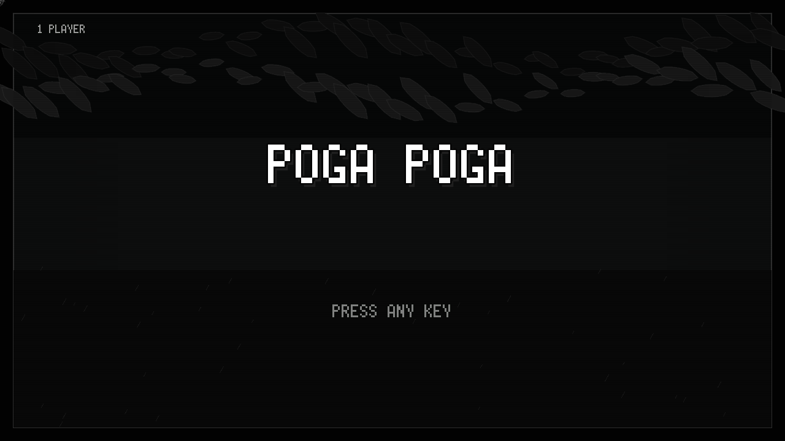 | 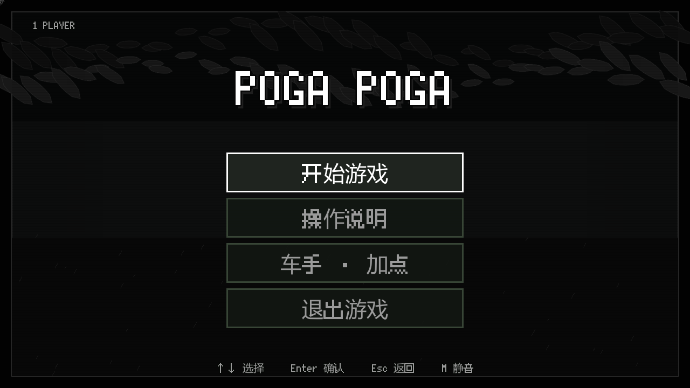 |

| 比赛（折线腰型耐力槽） | 暂停菜单（Esc） |
| --- | --- |
| 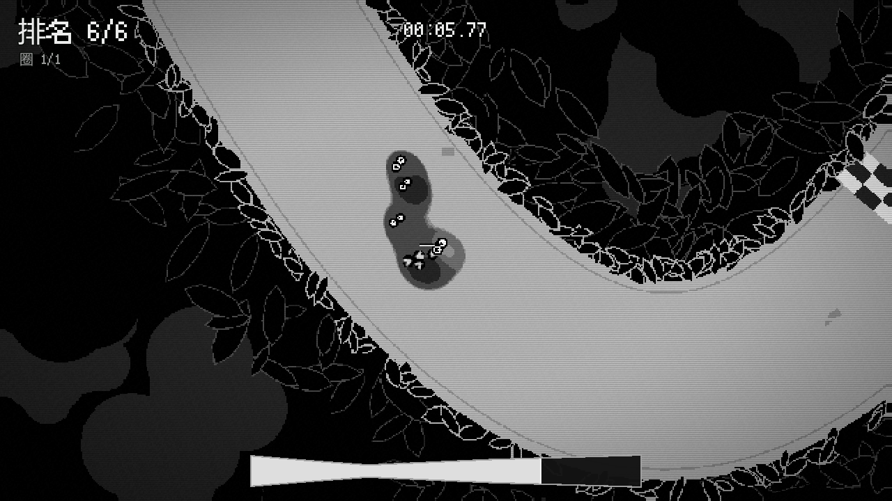 | 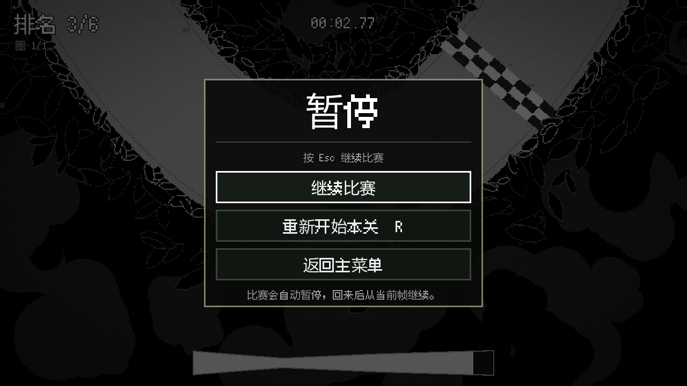 |

| 选择赛段（点击即出发） | 车手 / 加点 |
| --- | --- |
| 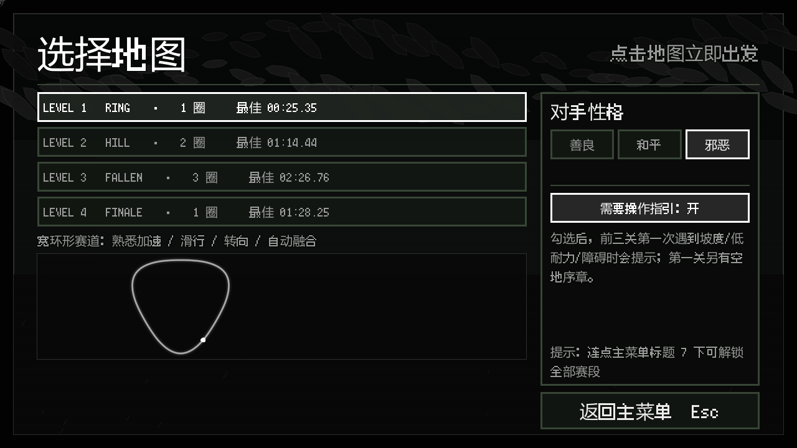 | 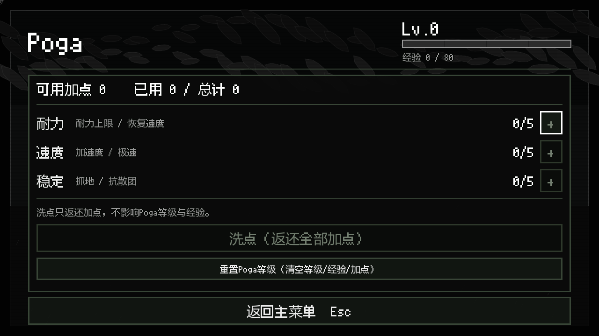 |

| 设置（操作/声音/画面） | FINALE 整图（调试预览） |
| --- | --- |
| 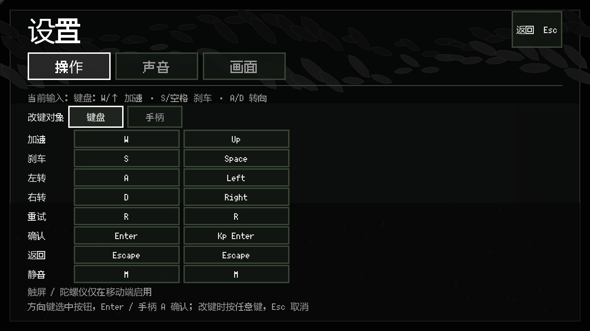 | 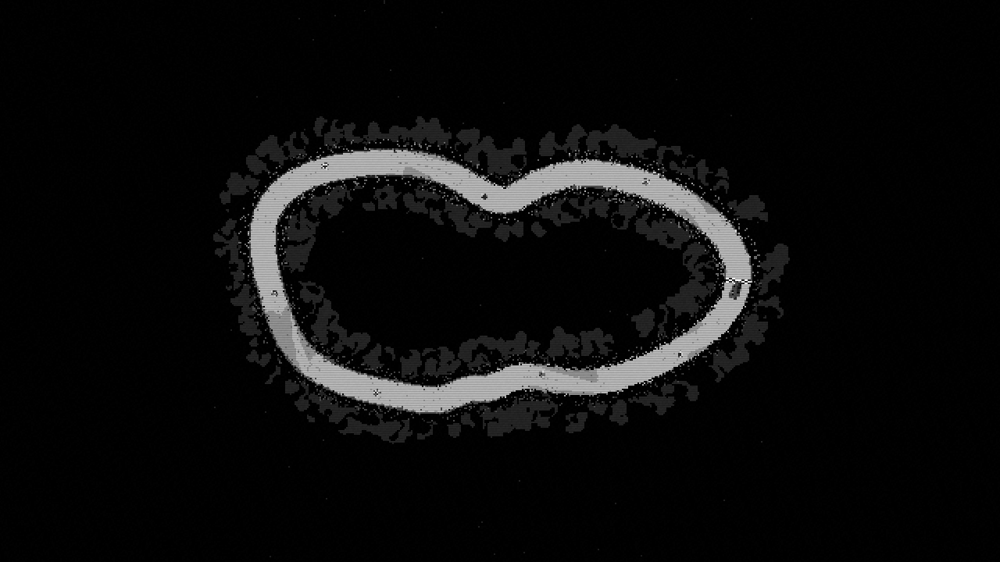 |

| 情境提示（1 秒 · 强聚焦） | 坡道视觉（上坡：变暗 + 箭头 + 斜线） |
| --- | --- |
| 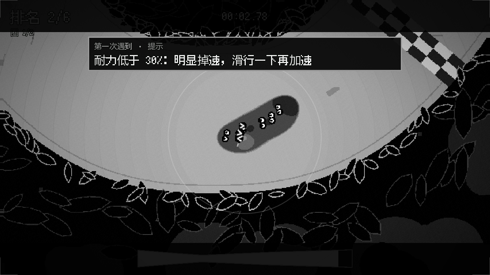 | 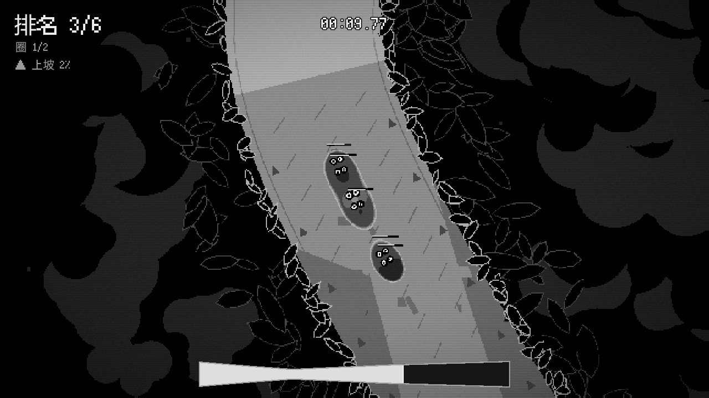 |

| 表情状态：低耐力 `--` / 耗尽 `==` / 碰撞 `><` / 爆炸分裂 |
| --- |
| 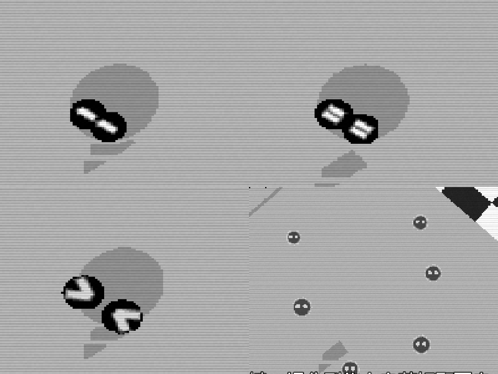 |

| FINALE 岩地赛段 | FINALE 高地赛段 |
| --- | --- |
| 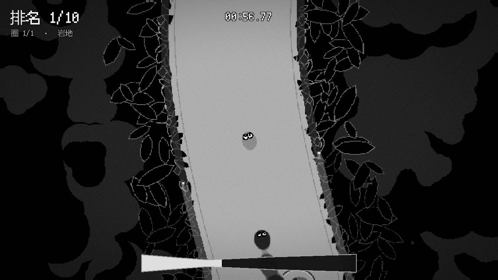 | 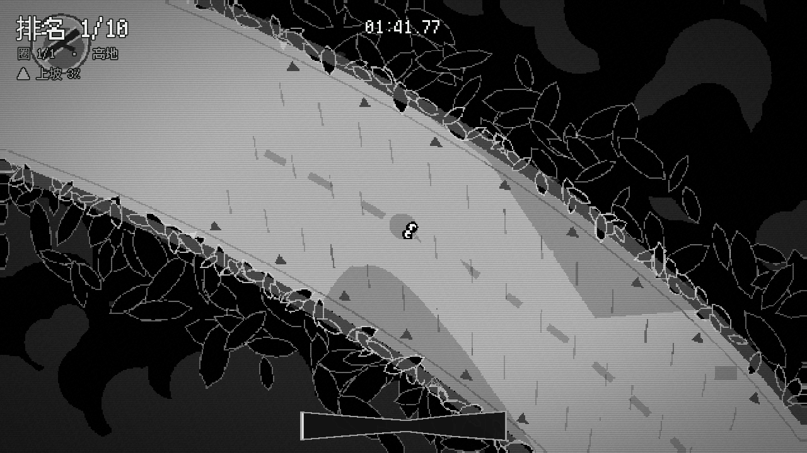 |

| 耐力条破碎（上限 <30%） | 下坡整片提亮 |
| --- | --- |
| 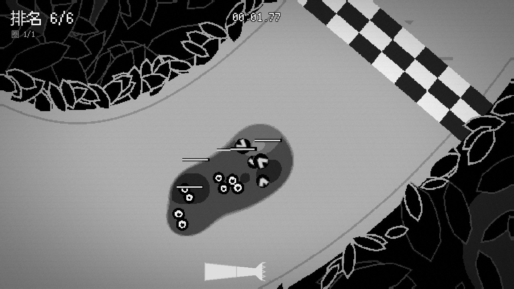 | 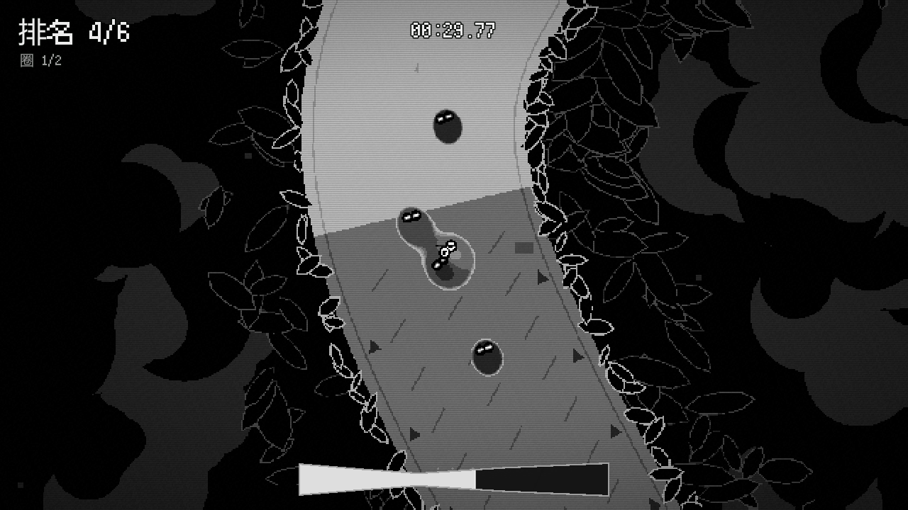 |

| 结算（数据靠右、逐条淡入） | 新手引导（空地+同款起跑线） |
| --- | --- |
| 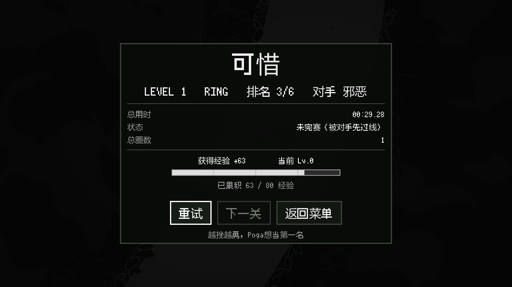 | 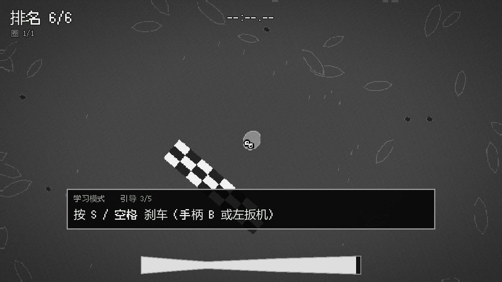 |

> 截图由 `godot --path . -- --shots` 与调试参数（`--reveal-menu` / `--pause-test` / `--show-help`）生成。

---

## 核心机制

### 1. 躯体融合：一坨黏液 + 各自的眼睛

- 融合团成员躯体中心间距仅 26px（小于两倍半径 36px），躯体必然重叠；
- 躯体由 [SlimeBlobLayer](src/view/blob_layer.gd) + [slime_blob.gdshader](shaders/slime_blob.gdshader) 的
  **metaball 场**实时合成：靠拢融成一坨、拉开自然断开；每只史莱姆的灰阶体色参与场混合，融合后仍能看出个体；
- 眼睛由各自的 `Racer` 画在黏液层之上（“融合后只露眼睛”），眼睛大小/间距是识别个体的主要线索，玩家眼睛更大更亮。

### 2. 碰撞 = 眼睛撞眼睛

- 躯体不互相碰撞（它们是融合的），只有眼睛是“硬”的；
- 同团内眼睛相撞：减速 + 稳定低谷 + 约束张力激增（`EYE_SHOCK`），撞得深会把整团撞散；
- 不同个体眼睛相撞：惩罚更重，双方直接脱离当前团；
- 眼睛间距会随团内张力挤近，越挤越容易撞。

### 3. 鼻涕虫式移动

最高速 215px/s、加速度低、侧向抓地低、滑行阻力小：起步肉、转向滑、松手还能溜很远。
加速力有轻微蠕动节律，配合黏液 shader 的呼吸/拉伸，移动像一拱一拱的鼻涕虫。

### 4. 黑白林间小道 + 树叶碰撞边界

纯灰阶画面；赛道两侧是成片**树叶轮廓**，贴边叶片同时是碰撞体（撞上会减速、掉耐力、可能散团），
外圈还有更暗的叶团与树冠剪影。障碍物（树枝/落叶/石子）带白描边与警示环。

### 5. 相机

固定俯视朝向，平滑跟随玩家；速度越快镜头略拉远、融合团越大略拉远。不再随角色旋转。

### 6. 成长与难度

- 车手等级 0~10：经验 = `70 × 关卡难度 × 排名系数 × AI 难度加成`；
- 加点界面：**洗点**只返还加点（不降等级/经验）；**重置车手等级**会清空等级/经验/加点，需二次确认；
- 升级所需经验 `80 + 30 × 当前等级`，每升 1 级获得 1 点自由加点；
- 属性三项（耐力/速度/稳定）等级 0~5，最终属性 = 基础 5 + 等级；重置按钮回到 Lv.0；
- 对手性格（善良 / 和平 / 邪恶）在菜单选择，三者统一使用困难难度数值；
  善良主动找 Poga 合体，和平正常跑；邪恶之间会优先组队协作，只对 Poga 甩开/冲撞；
  靠近时头顶显示当前耐力细线。

### 7. 耐力（v0.12 折线腰型槽）

- 耐力条是**折线轮廓的腰型槽**：槽长 = 临时上限（上限缩水时槽变短），始终水平居中；内部填充 = 当前耐力；
  **没有分段、没有数字、也没有刻线**——最窄的折点就是“耐力开始偏低”的位置（原始耐力的 30%，
  上限缩小时按 `0.30/cap` 动态换算），填充边缘越过它就代表见底。
- **崩溃线（v0.15）**：临时上限可以跌破 30%（下限 0.10）；一旦低于 30%，上限**不再自然恢复**，
  继续加速会持续流失；上限到 0.10 且耐力见底时触发**爆炸散开**。
- 上限一低于 30%，耐力条进入**破碎状态**：左侧残槽继续显示耐力，右侧锯齿裂口 + 旋转碎片飞散（1 秒动画）；
  残槽至少保留 260px 可读宽度；不再有槽体上方的闪烁白线。
- 团内/团外眼睛碰撞都会扣耐力；喘息锁定期间耐力保持 0，**回弹与上限下降同帧**；
- 爆炸后分裂成 7 只小史莱姆，**持续按移动键**才聚合，聚合为耐力 0.45 / 上限 0.75。
- 耐力低于 30% 才开始消耗临时上限；越低掉得越快，清空时额外加速掉上限；耐力恢复后上限恢复很慢。
- 耐力清空后进入 0.9 秒**喘息锁定**（不能加速）；喘息结束回弹一小段耐力时，**同一帧临时上限下降 0.10**
  （下限 0.10），并把耐力限制在新上限以内。
- **爆炸散开**：上限见底后再耗尽 → 史莱姆断开融合团、失控 2.4 秒并散成小团；结束后重新聚合，
  耐力回到 0.35、临时上限回到 0.55（可重新恢复），期间会震屏并播放低沉爆炸声。
- 耐力低时史莱姆发抖、眼睛下垂，并播放轻柔的喘息循环；清空瞬间一声短促的「吱！」。
- 耐力低时极速与加速度都会下降，滑行恢复比加速慢。

### 8. 表情形态与音效

- 两眼沿**运动方向的垂直方向**排列（连线随朝向旋转，和运动方向保持一致）；碰撞判定使用同一组眼睛坐标；
- 加速：两眼靠近；刹车：两眼拉远；碰撞：左眼“>”右眼“<”拼成 `><`（尖头相对）+ 左右晃动；
- 低耐力（<30%）：两只眼睛变成 `--`；耗尽：两只眼睛变成 `==`；
- 彻底耗尽爆炸：本体隐藏，分裂成 7 只小史莱姆各自游走；持续按移动键才聚合；
- 音效挂在玩家史莱姆上（位置音源）：加速为固定音高、按加速度改变发声间隔（3 个语气变体轮换）；刹车循环；碰撞一次性；低耐力喘息、清空吱声。

### 9. 音频资产（v0.12）

| 资产 | 内容 | 生成方式 |
| --- | --- | --- |
| `assets/sfx/winwin.wav` | 加速「win~ win~」拟声（循环） | Qwen3-TTS → 变调 1.62× → 叠小生物啁啾 → 循环交叉淡化 |
| `assets/sfx/pooo.wav` | 刹车「poo~」拟声（循环） | TTS → 变调 1.30× → 叠低频气声 |
| `assets/sfx/poga.wav` | 碰撞「poga」+ 闷响 | TTS → 变调 1.28× → 叠低频 thump 与噪声 click |
| `assets/sfx/ui_click/confirm/back.wav` | 按键点击 / 确认 / 返回 | 程序化合成 |
| `assets/music/forest_theme.ogg` | 48.5s 柔和森林风 BGM，循环 | 音乐盒（FM 木琴）+ 软铺底 + 轻风鸟鸣 + 卷积混响 + 母带（v0.8 重写，去掉电子感） |

- 全部音频由 `python tools/gen_audio.py` 重新生成；TTS 结果缓存在 `tools/.tts_cache/`（已 gitignore）。
- 无头自动测试完全不初始化音频，保证 CI 静音；GUI 下背景音乐以 -14dB 低音量播放，2 秒淡入，按 `M` 静音/恢复。
- 加速声（win~ win~）**音高固定**，有 3 个同音高、不同语气的变体；只在真正加速时一次性播放，
  提速越猛播放间隔越短（0.62s→0.20s）。使用播放器池轮换，**不会截断上一声**；滑行、匀速、刹车都不响。
- 低耐力音效不再是 TTS 呼吸，而是程序化合成的软喘息（`tired.wav`，两声一循环、渐入渐出）；
  耐力清空时播放短促的「吱！」（`gasp.wav`）。

### 10. 电子游戏机（CRT）画面

- 世界层统一经过 [pixelate.gdshader](shaders/pixelate.gdshader)：像素化 + 色阶量化 + 3px 周期扫描线 + 暗角 +
  轻微桶形畸变 + 荧光闪烁；
- HUD / 菜单 / 结算在更上层，不参与畸变，文字始终清晰；
- 保持纯灰阶，不加彩色色差。

### 11. 新手引导与情境提示（v0.14）

> 第一关有“开到起跑线才发车”的序章；前三关在**第一次遇到**坡度/低耐力/障碍/贴边/离团/融合/撞眼时
> 各弹一次 1 秒的情境提示。选关界面「需要操作指引：开/关」控制是否启用序章与情境提示（勾选后才有）。

- [tutorial.gd](src/ui/tutorial.gd) 在体力条上方显示实时提示，按动作条件推进：加速 → 转向 → 刹车 →
  自动融合 → 眼睛碰撞 → 目标；第二关教上坡/低耐力，第三关教障碍与树叶；
- 每步有触发条件与最长展示时间，条件达成或超时自动下一步；
- 默认每次进入前三关都会显示；`GameState.skip_tutorial` 为 true 时跳过（选关界面可切换）。

### 12. 坡道表现

- 不再用一排横线表示坡度：上坡铺**沿路渐变的亮色条带**、下坡铺**暗色条带**，两端淡出；
- 路两侧每 96px 画一个三角箭头：上坡朝行进方向、下坡朝反方向；
- HUD 左上角实时显示「▲ 上坡 6% / ▼ 下坡 5%」。

### 13. 四关（v0.12）

| 关卡 | 赛道 | 特点 |
| --- | --- | --- |
| LEVEL 1 RING | 圆角三角环 1 圈 | 教学：序章学移动 + 加速/滑行/转向/融合 |
| LEVEL 2 HILL | 大三角 2 圈 | 上坡耗耐、下坡转向变难 |
| LEVEL 3 FALLEN | 三角环 3 圈 | 树枝/落叶/石子障碍 |
| LEVEL 4 FINALE | 双回环大图 1 圈 | 约 12.8km；窄颈 + 两处减速弯 + 8 段坡道 + 7 处障碍 + 9 只对手；林间/旷野/岩地/高地四段地形 |

- 解锁链：赢下当前关解锁下一关，共 4 关；连点标题 7 下可直接解锁全部。
- 主菜单 → 选择赛段（点击即出发）/ 车手加点；设置项（难度、跳过引导）在选择赛段界面。

### 14. 主菜单与界面结构（v0.12）

- 主菜单：标题 + 「开始比赛 / 选关·难度 / 车手·加点 / 退出游戏」四个按钮，背景是 CRT 扫描线 + 史莱姆剪影；
- 选关界面：4 关列表（含最佳成绩）、对手性格、操作指引开关、开始 / 返回；
- 车手界面：等级、经验条、三属性加点、重置、返回；
- 三个界面共用 `MenuBackdrop`，与游戏内 CRT 画面保持同一套视觉语言；`Esc` 返回上一层。

---

## 已实现内容（对照策划案）

| 策划案条目 | 实现情况 |
| --- | --- |
| Demo 三关 + 环法两关（共 5 关） | ✅ `src/data/level_catalog.gd` |
| 玩家 + AI 5 只同台，个体第一过关 | ✅ `src/sim/race.gd` |
| 自动吸附 / 分离、眼睛约束、纵列增益、易散团 | ✅ `fusion_pack.gd` + `race.gd` 眼睛碰撞 |
| 团内调位（加速前移 / 刹车后移 / 转向偏移） | ✅ 纵向弹力刻意做软 |
| 碰撞：减速、稳定低谷、约束松弛、易散团 | ✅ 眼睛相撞触发 |
| 双层耐力、滑行恢复、刹车不是最优解 | ✅ `racer.gd`，HUD 可见波动 |
| 三属性与成长 | ✅ 经验升级 + 加点（比赛中锁定） |
| 每圈检查点、个体过线记圈、终点判定 | ✅ 弧长跨圈修正 + 检查点顺序校验 |
| AI：找团/跟车/耐心轮换/弯道/耐力/冲刺/避障/脱困 | ✅ `ai_driver.gd`（含三档难度） |
| HUD / 结算 / 加点 UI | ✅ 统一像素风格 |
| 黑白像素、林间小道、无融合提示、无玩家标识 | ✅ 纯灰阶 + metaball 黏液 + 眼睛识别 |
| 史莱姆形态与音效 | ✅ 眼睛形态 + 玩家位置音源 |
| 背景音乐与按键音效 | ✅ 森林风芯片 BGM + UI 点击/确认/返回 |
| 五关 + 环法赛段 | ✅ 3 关教学 + 2 关环法（平原/山地），解锁链 5 关 |
| 新手引导 | ✅ 前三关首次进入实时提示 |
| CRT 画面效果 | ✅ 扫描线/暗角/轻微曲面/闪烁 |
| 2.5D 微倾 / 真实坡度 | ⚠️ 仍为俯视 2D，坡度用分区速度/耐力修正近似 |
| 团体赛 / 服装系统 | ⏸ 未实现（保留个体记圈接口） |

## 简化与边界

- **团体赛**：仍只保留个体记圈/排名。
- **移动端触屏**：按住加速 + 横向拖动转向 + 双指刹车，未真机验证。
- **服装系统**：用体色灰阶 + 眼睛大小/间距区分个体。
- **坡度**：`LevelDef.slopes` 分区系数，无真实高度物理。
- **音频**：已有玩家拟声、森林 BGM 与 UI 按键音；暂无音量设置界面、无 BGM 分轨/场景切换变体。

---

## 工程结构

```
poga-poga/
├─ project.godot
├─ scenes/main.tscn               # 唯一入口场景（其余节点由脚本构建）
├─ src/
│  ├─ main.gd                     # 应用根：菜单/比赛/结算、像素化层、自动化测试入口
│  ├─ core/                       # game_state.gd（等级/经验/存档）、input_setup.gd（InputMap）
│  ├─ data/                       # tuning.gd（唯一数值源）、level_def.gd、level_catalog.gd
│  ├─ sim/                        # race_track / racer / fusion_pack / ai_driver / race
│  ├─ view/                       # track_view（赛道/树叶/障碍）、blob_layer（黏液层）
│  ├─ audio/                      # slime_audio（史莱姆拟声）、ui_sfx（按键音）、music_player（BGM）
│  └─ ui/                         # ui_kit / hud / main_menu / settlement
├─ shaders/
│  ├─ slime_blob.gdshader         # metaball 躯体融合
│  └─ pixelate.gdshader           # 像素化 + 色阶 + CRT 扫描线/暗角/曲面
├─ assets/
│  ├─ fonts/                      # Ark Pixel 10px 中文像素字体（OFL-1.1）
│  ├─ sfx/                        # winwin / pooo / poga / ui_*（拟声 + 按键音）
│  └─ music/                      # forest_theme.ogg（森林风芯片 BGM，循环）
├─ tools/
│  ├─ verify.ps1                  # 一键验证
│  └─ gen_audio.py                # 全部音频生成脚本（TTS 拟声 + BGM + 按键音）
├─ docs/screenshots/
├─ 策划案/
├─ README.md
└─ 项目规范.md
```

**渲染层级**（从下到上）：

```
0  世界：赛道(z=-10) → 黏液层(z=5) → 眼睛(z=10/20)
1  PixelLayer：全屏像素化 + 色阶量化
2  HUD（CanvasLayer）
3  UI：菜单 / 结算（CanvasLayer）
```

---

## 自动化验证

```powershell
# 导入 + 启动检查 + 三关自动跑 + 难度档位冒烟 + 机制验证
powershell -NoProfile -File tools\verify.ps1

# 额外生成 3 张界面截图
powershell -NoProfile -File tools\verify.ps1 -Shots
```

单条命令：

```bash
godot --headless --path . --fixed-fps 60 -- --autotest --level=1 --tier=1
godot --headless --path . --fixed-fps 60 -- --autotest --pattern=mechanics
godot --path . --resolution 1280x720 -- --shots
# 调试：--force-tutorial 强制新手引导 / --skip-tutorial 跳过 / --reveal-menu 直接展开主菜单 / --pause-test 自动打开暂停
```

输出字段：

| 输出 | 含义 |
| --- | --- |
| `AUTOTEST_RESULT level/tier/won/rank/time/laps/xp/level_after` | 单关自动跑结果（玩家由 AI 接管） |
| `AUTOTEST_RANKING` | 每个个体的进度与平均速度 |
| `AUTOTEST_STATS absorb/detach/eye_coll/leaf_coll/debris_coll/offroad_ratio/packs` | 融合/散团、眼睛碰撞、树叶/障碍碰撞、越野比例 |
| `AUTOTEST_STAMINA min/max/cap_min/eye_form` | 耐力波动范围、眼睛形态倍率范围（<1 加速挤近，>1 刹车拉远） |
| `MECHANICS fused/detach/reabsorb/eye_form` | 自动吸附 → 主动散团 → 重新吸附，以及形态验收 |

**当前基线**（Godot 4.7.2 / Windows，`--fixed-fps 60`，对手性格=和平，AI 种子固定，角色为 0 级无加点）：

| 关卡 | 自动跑结果 |
| --- | --- |
| 第 1 关 RING（1 圈） | `rank=3 time=28.12 xp=63`，`explosions=0` |
| 第 2 关 HILL（2 圈） | `rank=4 time=74.53 xp=57`，`explosions=3` |
| 第 3 关 FALLEN（3 圈） | `rank=6 time=122.40 xp=29`，`explosions=6` |
| 第 4 关 FINALE（1 圈 12.8km） | `rank=7 time=105.55 xp=37`，`explosions=8` |
| 机制 | `fused_at=0.00 detach_at=4.22 reabsorb_at=9.02 max_pack=4 eye_form=0.78..1.30` |
| 耐力联动 | `--stamina-check` → `STAMINA_CHECK PASS cap=0.60->0.46` |
| 爆炸聚合 | `--explode-check` → `EXPLODE_CHECK PASS stamina=0.45 cap=0.75` |
| 暂停自检 | `--pause-check` → `PAUSE_CHECK PASS` |

> 自动测试使用中性角色（0 级、无加点、不写存档），基线不受玩家进度影响。

## 调参指南

| 想改什么 | 看哪里 |
| --- | --- |
| 移动手感（慢/黏） | [tuning.gd](src/data/tuning.gd)：`BASE_MAX_SPEED`、`BASE_ACCEL`、`LATERAL_GRIP`、`COAST_DRAG_BASE`、`GOO_PULSE_*` |
| 耐力 | `DRAIN_ACCEL / DRAIN_CAP / REGEN_*`；耐力条在 `hud.gd` |
| 融合 | `PACK_*`、`ABSORB_*`、`EYE_*` |
| 难度 | `AI_TIER_SPEED / MISTAKE / BRAKE / PATIENCE / FUSE / STATS` |
| 成长 | [game_state.gd](src/core/game_state.gd)：`XP_BASE / XP_GROWTH / BASE_XP / RANK_XP_COEF / AI_TIER_XP_COEF / LEVEL_MAX` |
| 关卡 | [level_catalog.gd](src/data/level_catalog.gd)：圈数、宽度、AI 基础参数、坡度、障碍物 |

改完跑 `tools/verify.ps1`：重点看 `AUTOTEST_STATS`（机制是否发生）、`AUTOTEST_STAMINA`（耐力/形态是否在动）、
`AUTOTEST_RESULT`（时长与经验）。

---

## 已知问题 / 后续

1. 音频暂无设置界面与音量滑条（只有 `M` 静音）；后续可补 BGM 分轨、低声环境层与音量设置。
2. 触屏方案未真机验证。
3. AI 突围意识弱：简单档中自动跑会被慢团拖住（人类玩家影响较小）。
4. 融合团 churn 仍偏高（一场 10~30 次融合/散团），后续可加“撞眼后短暂免疫”。
5. 无暂停菜单、无设置项（`F3` 切像素化；`M` 切音乐）。
6. 环法两关刚扩量，圈数/坡度/障碍密度与 9 只 AI 的平衡需要真人试玩校准（自动驾驶在 CLIMB 很容易掉到后段）。
7. 新手引导目前只在第 1~3 关；第 4/5 关没有专门引导。
8. BGM 换成音乐盒风后，仍建议实际试听确认音色与音量；可用 `M` 静音。
9. FINALE 的 9 只 AI 与障碍密度较大，集团 churn 偏高，需要真人试玩后决定是否减到 8 只。
10. 耐力清空锁定时长、上限掉速、回弹时上限掉一截的数值（`STAMINA_CAP_SNAP` / `STAMINA_BOUNCE` / `STAMINA_CAP_FLOOR`）都在 `Tuning` 里，可按手感微调。
11. win~ win~ 现在是“固定音高 + 3 个语气变体 + 可变间隔”，如果还嫌单调可以继续加变体（生成链已支持）。
12. 暂停发生在新手引导慢动作期间时，恢复后仍会继续慢动作（设计如此）；若希望暂停自动恢复 1.0× 可再调。
13. 重置车手等级会清空等级/经验，但保留关卡解锁与最佳成绩；洗点只影响三属性加点。
14. FINALE 目前是 1 圈约 12.8km 的大图，跑完约 110 秒；需要真人试玩确认长度与地形节奏是否合适。
15. 情境提示目前是全局“第一次”触发；如果希望每关都重新提示，可以把 `tips_seen` 按关卡分开存。
16. 爆炸后上限 0.75 / 耐力 0.45 是初版；如果觉得爆炸太频繁，可继续调 `STAMINA_EXPLODE_*` 或 `DRAIN_CAP_*`。
17. 团内眼睛碰撞扣耐力后，集团缠斗会更耗耐力；如果手感太严，可把 `EYE_STAMINA_DRAIN` 再调低。

## 素材与许可

- **字体**：Ark Pixel Font 10px（TakWolf），SIL OFL-1.1，见 `assets/fonts/OFL.txt`。
- **史莱姆拟声**：Qwen3-TTS（`qwen3-tts-flash`，DashScope 兼容接口）生成原始语音后，用 `tools/gen_audio.py` 做变调/叠层/循环处理；不使用第三方音频素材。
- **BGM / 按键音**：`tools/gen_audio.py` 纯 numpy 程序化合成，无第三方版权。
- **图标**：Godot 模板 `icon.svg`。